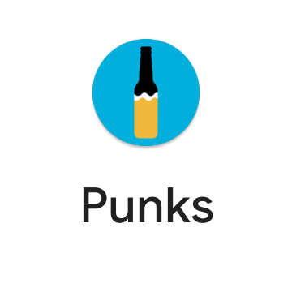
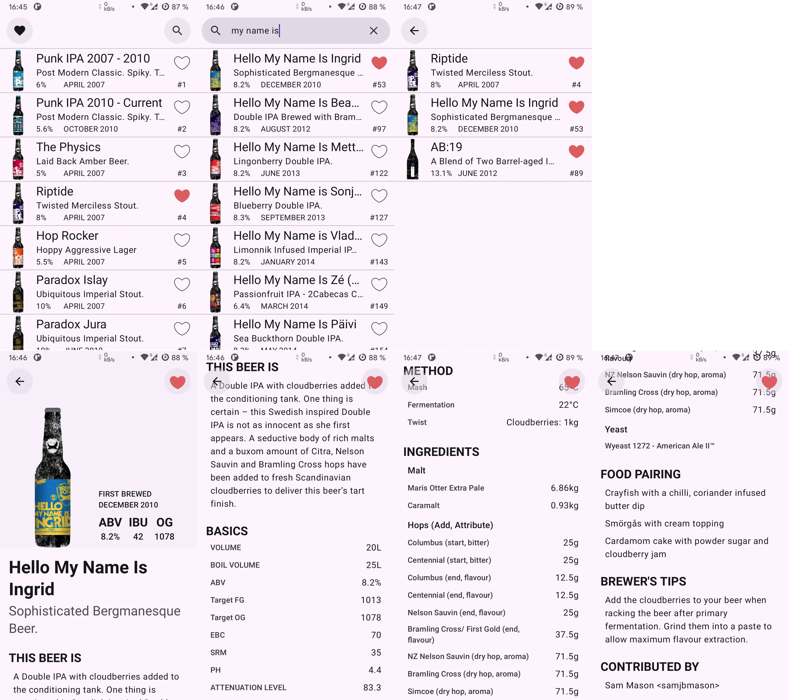

# Punks

An Android application built around the [PunkAPI](https://github.com/alxiw/punkapi) — a mobile catalog of BrewDog beers.

## Features

- **Catalog** — browse the complete BrewDog beer lineup
- **Search** — look up beers by name right from the top bar
- **Beer details** — dive into a beer's full profile: brewing parameters, recipe breakdown, and food pairings
- **Favorites** — heart any beer and find it later on a dedicated screen

## Architecture

Punks started as a refactor of [this project](https://github.com/iiinaiii/Punks), but eventually grew into a standalone app that covers all the functionality of [Punk Brew](https://github.com/alxiw/punk-brew) — rewritten from scratch on a modern stack.

The app follows Clean Architecture with a clear separation of data, domain, and presentation layers. Network responses are cached on disk via OkHttp, and beer images are cached independently via Coil — so both content and artwork stay available offline after the first load. Pagination is handled by Paging 3. Favorites are persisted locally in DataStore preferences. The UI is built entirely with Jetpack Compose with full edge-to-edge support.

The app follows Clean Architecture. Data is fetched with pagination via Paging 3, cached locally via OkHttp cache. The UI is based on Jetpack Compose and built with edge-to-edge support.

## Screenshots

## Tech Stack

* [Kotlin](https://github.com/JetBrains/kotlin) 2.4.21
* [Jetpack Compose](https://developer.android.com/compose) 1.12.1
* [Navigation](https://developer.android.com/guide/navigation) 2.10.2
* [Hilt](https://github.com/google/dagger) 2.60.1
* [Coroutines](https://github.com/Kotlin/kotlinx.coroutines) 1.11.0
* [OkHttp](https://github.com/square/okhttp) 5.5.0
* [Retrofit](https://github.com/square/retrofit) 3.0.0
* [Moshi](https://github.com/square/moshi) 1.15.2
* [DataStore](https://developer.android.com/topic/libraries/architecture/datastore) 1.2.1
* [Paging](https://developer.android.com/topic/libraries/architecture/paging) 3.5.3
* [Coil](https://github.com/coil-kt/coil) 2.7.0
* [ThreeTen Backport](https://www.threeten.org/threetenbp/) 1.7.3

## License

[MIT](LICENSE) © [alxiw](https://github.com/alxiw)
